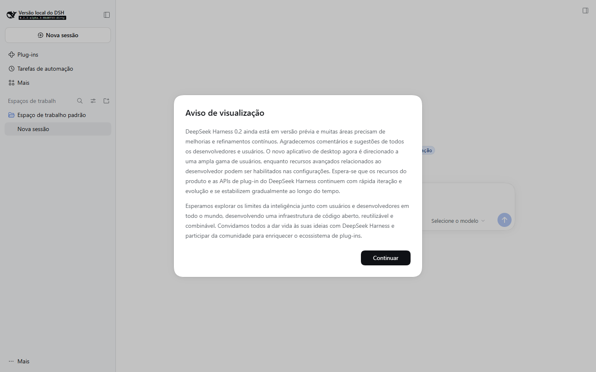
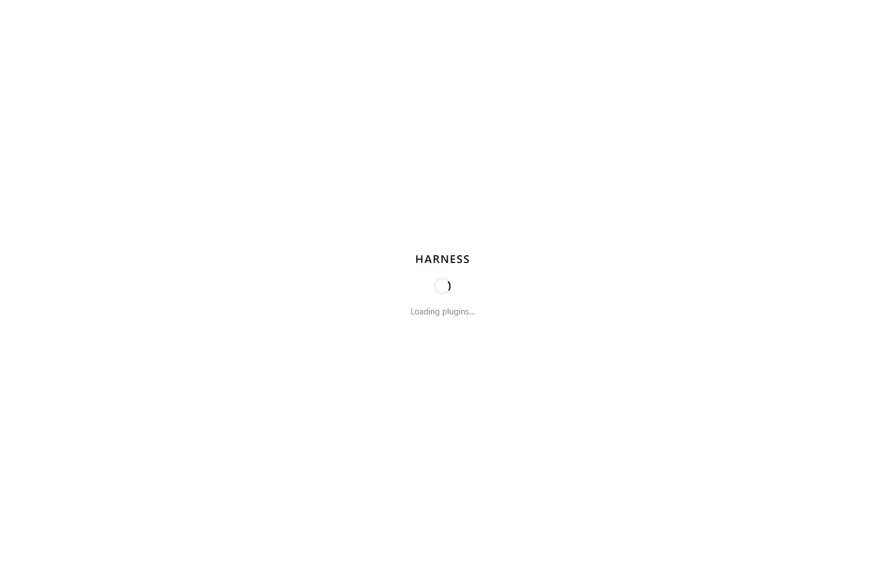

# A3a — fumaça de linha de base (nada renomeado)

Data: 2026-11-03T16:25:48.392Z → 2026-11-03T16:29:22.028Z (total 213636 ms)
Máquina: Windows x64, Node 24.22.1, pnpm 11.28.5
Electron pacote: 44.7.0
Electron runtime: {"node":"24.21.0","electron":"44.7.0","chrome":"152.0.7977.130"}
Binário: `C:\Users\migue\dev\persona\apps\desktop\node_modules\electron\dist\electron.exe`
Artefatos desktop: main.js=true host=true
Homes temporários: `DSH_HOME`/`PERSONA_HOME` = `C:\Users\migue\dev\persona\.maestri\tmp\rivet-home`; `DSH_DESKTOP_USER_DATA_DIR` = `C:\Users\migue\dev\persona\.maestri\tmp\rivet-userdata`
Flags: `DSH_TELEMETRY_DISABLED=1`, `DSH_DESKTOP_OPEN_DEVTOOLS=0`

## 1. install-electron

- Comando: `pnpm --filter @deepseek-ai/dsh-desktop exec install-electron`
- Tempo: 12348 ms (esta sessão; avisos de plataforma nativa darwin/linux, esperado no Windows)
- Resultado: OK — electron.exe presente
- Caminho: `C:\Users\migue\dev\persona\apps\desktop\node_modules\electron\dist\electron.exe`

## 2. Web (`dsh web --no-open`)

- Comando (sob trava): `node --import tsx/esm apps/cli/src/bin.ts web --no-open --port 18080`
- Tempo até captura: 22195 ms
- URL (token omitido): http://127.0.0.1:18080/?token=<redacted>
- Título: Versão local do DSH
- Resultado: OK
- Captura: 

## 3. Desktop (`pnpm start:desktop` / `dev:desktop` se faltar build)

- Comando (sob trava): `pnpm run start:desktop (tsx --skip-build)`
- CDP: http://127.0.0.1:19222
- Tempo até captura: 188793 ms
- Página: dsh-app://app/
- Título: DSH Local Build
- Resultado: OK
- Captura: 

## O que a UI mostrou (nada renomeado — esperado)

- **Web:** diálogo "Aviso de visualização" (DeepSeek Harness 0.2.2 preview) sobre a shell "Versão local do DSH"; botão Continuar. Marca e Welcome ainda são do upstream.
- **Desktop:** primeira pintura via CDP (~13 s após o renderer escutar) é o splash `HARNESS` / "Loading plugins…", título `DSH Local Build`, URL `dsh-app://app/`. A janela abriu; a conversa ainda não tinha montado.

## Falhas / ruídos reproduzíveis (não bloquearam a captura)

1. **`spawn pnpm` sem `shell` no Windows = `ENOENT`.** `pnpm run start:desktop` via `child_process.spawn('pnpm', …)` falha. Contorno desta fumaça: `node --import tsx/esm apps/desktop/scripts/dev.ts --skip-build` (equivalente ao `start` do pacote). `pnpm.cmd --version` funciona com `shell: true`.
2. **IPC `dsh-desktop:mandatory-status`:** `Error: No handler registered for 'dsh-desktop:mandatory-status'` no main, no boot. Não derrubou a janela.
3. **Aviso de CSP do Electron** no renderer de desenvolvimento (`unsafe-eval` / sem policy). Some no empacotado.
4. Primeira tentativa desta sessão roubou lock stale de `Probe persona-e2e startDesktop` (pid já morto).

Encerramento: `taskkill /T /F` na árvore de cada processo filho. A3b (renomear/desacoplar DeepSeek) **não** foi feita.
